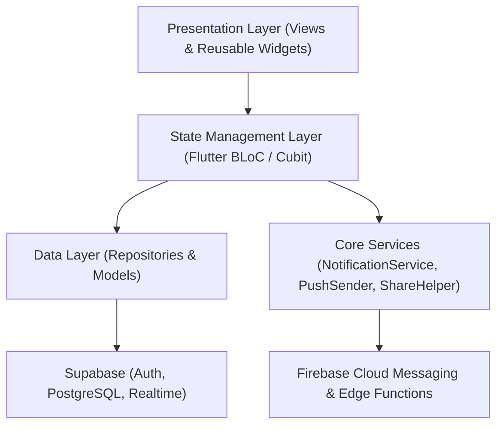

<div align="center">

# 🛒 بقالتي — Baqalati
### دفتر الحسابات والديون الرقمي الذكي بين التاجر والزبون
**Real-Time Digital Credit & Grocery Ledger Built with Flutter & Supabase**

[](https://flutter.dev)
[](https://dart.dev)
[](https://bloclibrary.dev)
[](https://supabase.com)
[](https://firebase.google.com)
[](https://developer.android.com)

</div>

---

## 📖 نبذة عن المشروع | Overview

**بقالتي (Baqalati)** هو تطبيق للهواتف الذكية يعالج مشكلة الدفاتر الورقية التقليدية لتسجيل الحسابات الآجلة (الديون) بين أصحاب البقالات والمتاجر المحلية وزبائنهم. يوفر التطبيق سجلاً رقمياً مشتركاً وموثقاً يعمل **بالزمن الحقيقي (Real-Time)**، بحيث تصل إشعارات فورية للزبون فور تسجيل أي عملية بيع أو دفعة تسديد مع إمكانية مشاركة كشف الحساب المفصل عبر واتساب بضغطة زر.

> **Project Summary (English):** *Baqalati* digitizes neighborhood grocery credit ledgers with a dual-role mobile experience (**Merchant** & **Customer**). Powered by **Flutter**, **BLoC/Cubit**, **Supabase Realtime**, and **Firebase Cloud Messaging (FCM)**, every credit sale or payment recorded by a merchant instantly syncs to the customer's device with foreground/background push notifications and automated net-balance reconciliation.

---

## ✨ أبرز المميزات | Key Features

### 🏪 واجهة التاجر (Merchant Experience)
- **لوحة ملخص ديون السوق:** عرض إجمالي المديونيات المستحقة للتاجر لدى كافة العملاء مع عدد العملاء المدينين.
- **بحث وفلترة ذكية:** البحث الفوري بالاسم أو رقم الحساب، مع فلاتر سريعة (`الكل`، `عليه مديونية`، `خالص`) وترتيب تلقائي للأعلى مديونية.
- **إدارة المشتريات والدفعات:**
  - إضافة أصناف آجل مع السعر والكمية والملاحظات والتحقق الصارم من المدخلات.
  - تعديل أو حذف العمليات عند حدوث خطأ إدخال.
  - **تسديد الحساب (كلي أو جزئي):** أزرار مبالغ سريعة + زر «تسديد الكل» + سجل مستقل للدفعات المسددة يُخصم تلقائياً من إجمالي المشتريات.
- **مشاركة الرقم التعريفي وكشف الحساب:** نسخ الكود التعريفي للبقالة أو إرساله عبر واتساب للعملاء الجدد، ومشاركة كشف حساب نصي منسق يشمل المشتريات والدفعات والصافي المتبقي.

### 👤 واجهة الزبون (Customer Experience)
- **الربط السريع بالمتاجر:** إضافة أي بقالة باستخدام رقمها التعريفي الفريد مع منع التكرار.
- **شفافية مالية لحظية:** متابعة صافي الديون المستحقة لدى جميع المتاجر، ورصيد كل متجر وتاريخ آخر حركة شراء.
- **إشعارات فورية مزدوجة المسار:**
  - استلام تنبيه فوري بصوت واهتزاز وتحديث تلقائي للشاشة المفتوحة عبر **Supabase Broadcast & Postgres Changes**.
  - استلام إشعارات **FCM Push Notifications** عبر **Supabase Edge Functions** عندما يكون التطبيق مغلقاً في الخلفية، مع الانتقال المباشر لتفاصيل المتجر عند النقر على الإشعار.
- **حماية الحقوق المالية:** منع فك الارتباط بالمتجر أو حذف الحساب ما دام هناك رصيد مديونية متبقٍ أكبر من الصفر.

### 🔐 المصادقة والأمان (Auth & Security)
- تسجيل حساب جديد بدخول مباشر فوري (تاجر أو زبون) مع التحقق الكامل من الحقول.
- استعادة كلمة المرور عبر البريد الإلكتروني والروابط العميقة (**Android Deep Links** `io.supabase.flutter://reset-callback`).
- عزل المفاتيح السرية خارج الكود المصدري (`AppConfig` + `--dart-define` + `env_secrets.dart` المستثنى من Git).
- تنظيف رمز إشعارات الجهاز (`fcm_token`) تلقائياً عند تسجيل الخروج لمنع تسرب التنبيهات بين الحسابات، ودعم حذف الحساب بما يتوافق مع متطلبات متجر Google Play.

---

## 🏗️ المعمارية وهيكلية المشروع | Architecture & Project Structure

يتبع المشروع معمارية **Feature-First Architecture** مقسمة بوضوح حسب نطاق العمل (`Auth`, `Merchant`, `Customer`, `core`) مع فصل طبقة البيانات (`data`: Models & Repositories) عن طبقة العرض وإدارة الحالة (`presentation`: Cubit/BLoC, Views, Widgets).



```text
lib/
├── core/
│   ├── routes/          # إعداد مسارات التطبيق عبر GoRouter
│   ├── services/        # خدمات الإشعارات المحلية، FCM، ومستمع Supabase اللحظي
│   ├── utils/           # إعدادات البيئة الآمنة ومساعد المشاركة عبر واتساب
│   └── Widgets/         # مكوّنات التحميل والتنبيهات المشتركة
├── Features/
│   ├── Auth/            # تسجيل الدخول، إنشاء الحساب المباشر، واستعادة كلمة المرور
│   ├── Merchant/        # إدارة العملاء، المشتريات، الدفعات المسددة، وإعدادات المتجر
│   └── Customer/        # ربط المتاجر، متابعة الكشوفات اللحظية، وإعدادات العميل
├── add_provider.dart    # تسجيل مزودات الحالة (MultiBlocProvider)
└── main.dart            # نقطة انطلاق التطبيق والسمة العامة ودعم العربية (RTL)
```

---

## 🛠️ التقنيات المستخدمة | Tech Stack

| المجال | التقنية / الحزمة | الدور في المشروع |
| :--- | :--- | :--- |
| **Framework** | `Flutter` & `Dart 3` | بناء واجهات أصلية عالية الأداء بدعم كامل للعربية (RTL) وMaterial 3 |
| **State Management** | `flutter_bloc` (Cubit) | فصل منطق الأعمال عن الواجهات وإدارة الحالات بشكل متوقع وقابل للاختبار |
| **Navigation** | `go_router` | إدارة التنقل والمسارات ومعالجة الروابط العميقة (Deep Linking) |
| **Backend & DB** | `supabase_flutter` | المصادقة (PKCE Auth)، قاعدة بيانات PostgreSQL، وقنوات التحديث الفوري |
| **Serverless** | `Supabase Edge Functions` | دالة TypeScript/Deno لإرسال إشعارات FCM HTTP v1 بأمان عبر Service Account |
| **Notifications** | `firebase_messaging` + `flutter_local_notifications` | إشعارات الخلفية والواجهة مع قنوات تنبيه مخصصة للأندرويد |
| **Utilities** | `url_launcher`, `shared_preferences`, `audioplayers` | المشاركة عبر واتساب، حفظ التفضيلات المحلية، والمؤثرات الصوتية |

---

## 🚀 طريقة التشغيل محلياً | Getting Started

### 1. المتطلبات الأساسية
- **Flutter SDK** `^3.11.0`
- مشروع على منصة [Supabase](https://supabase.com)
- مشروع على منصة [Firebase](https://console.firebase.google.com) (لإشعارات أندرويد)

### 2. تجهيز قاعدة البيانات (Supabase Setup)
1. افتح **SQL Editor** في لوحة تحكم Supabase ونفّذ ملف المخطط والسياسات المرفق:
   [`supabase/schema_and_rls.sql`](supabase/schema_and_rls.sql)
2. لتفعيل الدخول المباشر فور التسجيل (بدون تأكيد البريد بـ OTP):
   انتقل إلى **Authentication → Providers → Email** وأوقف خيار **Confirm email**.
3. أضف رابط الاستعادة العميق في **Authentication → URL Configuration → Redirect URLs**:
   `io.supabase.flutter://reset-callback/`

### 3. إعداد المفاتيح السرية و Firebase
لحماية المفاتيح السرية من الرفع على GitHub، يستخدم المشروع ملفات إعداد محلية مستثناة في `.gitignore`:

```bash
# 1. انسخ ملف قالب المفاتيح السرية وأضف بيانات مشروعك في Supabase
cp lib/core/utils/env_secrets.example.dart lib/core/utils/env_secrets.dart

# 2. انسخ ملف قالب Firebase أو ضع ملف google-services.json الخاص بتطبيقك (com.myshop)
cp android/app/google-services.example.json android/app/google-services.json
```

> 💡 **بديل لبيئات الإطلاق و CI/CD:** يمكنك تمرير المفاتيح مباشرة وقت البناء عبر `--dart-define`:
> ```bash
> flutter build apk --release \
>   --dart-define=SUPABASE_URL=https://your-project.supabase.co \
>   --dart-define=SUPABASE_ANON_KEY=your-anon-key
> ```

### 4. تثبيت الحزم والتشغيل والاختبار

```bash
# جلب الحزم
flutter pub get

# فحص جودة الكود والتحليل الثابت
flutter analyze

# تشغيل الاختبارات الآلية
flutter test

# تشغيل التطبيق على جهاز أندرويد أو محاكي
flutter run
```

### 5. توقيع نسخة المتجر (Android Release Signing)
انسخ ملف [`android/key.properties.example`](android/key.properties.example) إلى `android/key.properties` وأدخل بيانات ملف الـ Keystore الخاص بك، ثم شغّل:
```bash
flutter build appbundle --release
```

---

## 📸 لقطات الشاشة | Screenshots

| شاشة البداية والدخول | لوحة تحكم التاجر | كشف الحساب وتسديد الدفعات | واجهة متاجر الزبون |
| :---: | :---: | :---: | :---: |
| *أضف صورة هنا* | *أضف صورة هنا* | *أضف صورة هنا* | *أضف صورة هنا* |

---

## 📄 الترخيص | License

هذا المشروع مطوّر لأغراض الاستخدام التجاري والعرض الهندسي ضمن معرض الأعمال البرمجية (Portfolio). جميع الحقوق محفوظة ©.
